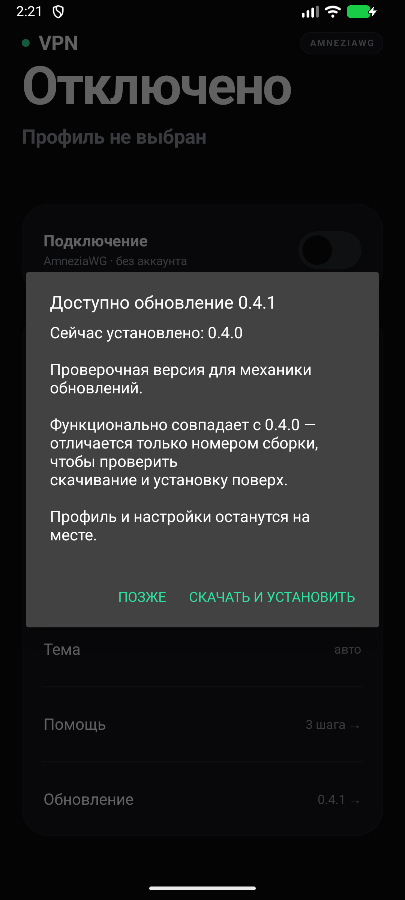
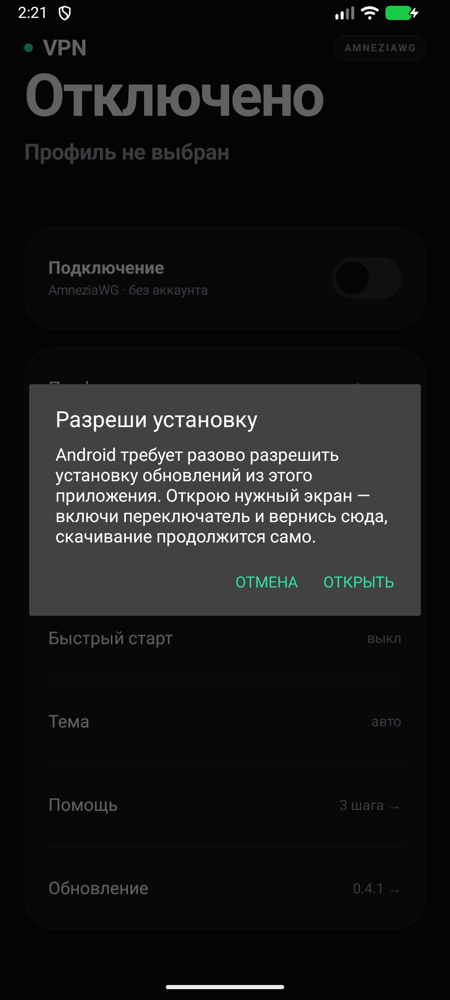
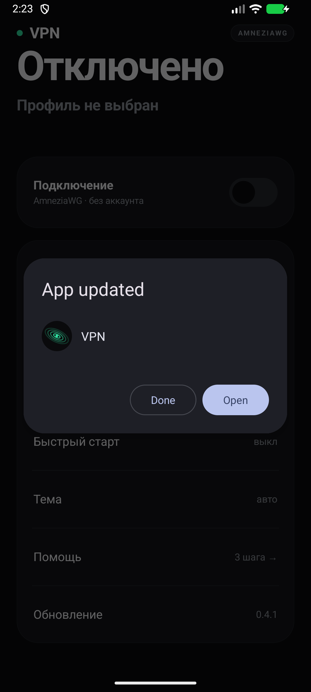

# VPN для Android

Лёгкий клиент одного сервера AmneziaWG: тумблер, импорт профиля файлом или QR-кодом,
плитка в шторке и автоматическое подключение после перезагрузки.
Один APK на всех — каждому устройству нужен свой `.conf`.

## Что внутри

- `app/` — Android-приложение на Kotlin, без Compose: весь интерфейс собран кодом.
- `engine/` — мобильное ядро AmneziaWG на Go, собирается в `app/libs/engine.aar`.
- `scripts/build-android.ps1` — сборка ядра и APK одной командой.

## Экран

Минимализм: крупный заголовок состояния, карточка «Подключение» с тумблером и
таймером сессии, строки «Профиль / Автоподключение / Тема / Помощь».
Тема следует системной (авто), вручную переключается на светлую или тёмную.
Работает на Android 6.0+ (minSdk 23, targetSdk 35).

## Профиль

`.conf` выдаёт тот, кто настраивал сервер, отдельно на каждое устройство.
Импорт: «Профиль» → «Выбрать .conf» или «Сканировать QR» (если QR уже сгенерирован).
Файл хранится в закрытой папке приложения и шифруется ключом Android Keystore.
Конфигурация не вшита в APK.

## Сборка

Нужны Android SDK с NDK, JDK 17+ и Go. Портативный Go:

1. Скачай `https://go.dev/dl/` → `go1.27.3.windows-amd64.zip` (или новее).
2. Распакуй в `%LOCALAPPDATA%\vpn-build\go` так, чтобы был файл
   `%LOCALAPPDATA%\vpn-build\go\go\bin\go.exe` (архив распаковывается с папкой `go`).
3. Если Go уже стоит в `C:\Program Files\Go`, скрипт найдёт его сам;
   свой путь можно задать через `$env:VPN_GO_ROOT`.

Дальше из PowerShell:

```powershell
.\scripts\build-android.ps1 -BuildApk
```

Скрипт поставит `gomobile` в локальный GOPATH, соберёт `app\libs\engine.aar`
под arm, arm64 и x86_64 (эмулятор) и запустит Gradle.
Готовый APK: `app\build\outputs\apk\debug\app-debug.apk`.

Папки сборки по умолчанию лежат в `%LOCALAPPDATA%\vpn-build`
(Go, GOPATH, кэш Go), чтобы не раздувать проект. Переопределяется через `$env:VPN_BUILD_ROOT`.

В Android Studio: открыть папку `apps\vpn-android`, дождаться синхронизации Gradle,
запустить конфигурацию `app`. Перед этим должен существовать `engine.aar`, иначе
`GoEngine` выбросит «Не удалось запустить AmneziaWG» — это ожидаемо.

## Подключение и плитка

При первом включении Android спросит разрешение на VPN. Дальше:

- тумблер на главном экране — включить/выключить туннель;
- плитка «VPN» в шторке работает на Android 7+;
- «Автоподключение» возвращает туннель после перезагрузки телефона.

Туннель держит foreground-служба с уведомлением и кнопкой «Отключить».
Если сервер не ответил на handshake за 15 секунд, приложение показывает
«Нет ответа» — туннель включён, но трафик, скорее всего, не идёт.

## Проверено на эмуляторе

Android 17 (API 37), AVD `Medium_Phone_API_37.0`:

- импорт `.conf` через системный пикер — профиль сохраняется, на главном экране
  показывается хост сервера и пометка «готов»;
- подключение: запрос разрешения на VPN → «Подключаемся» → «Нет ответа»
  (тестовый сервер не отвечал), туннель стартует, иконка ключа в статус-баре есть;
- отключение тумблером возвращает «Отключено»;
- переключение темы вручную (авто → светлая → тёмная) работает при тёмной системе;
- после перезагрузки с включённым «Автоподключением» служба поднимается сама
  (видно в `dumpsys activity services com.dryakhlitsyn.vpn`).

Не проверено: плитка в шторке на живом устройстве и подключение к настоящему серверу.

## Что важно знать

- Приложение принимает профиль с одним peer и поля `Address`, `DNS`, `AllowedIPs`, `MTU`.
- Ключи не уходят в сеть и не логируются.
- Начиная с 0.4.0 APK подписан своим release-ключом, а не debug-подпиской.

## Обновления без магазина приложений

Внизу главного экрана есть строка «Обновление». Нажал — приложение читает манифест
последнего релиза, сравнивает `versionCode` и, если версия новее, скачивает APK и
открывает системный установщик. Ставится поверх: профиль, настройки и разрешение
VPN остаются на месте.

Как это устроено:

- манифест — ассет `latest.json` последнего релиза:
  `https://github.com/mikerikichdimas2000-del/vpn-android/releases/latest/download/latest.json`;
- в манифесте `versionCode`, `versionName`, прямая ссылка на APK, SHA-256 и текст
  «что нового»;
- приложение проверяет: ссылка по https, SHA-256 совпал, имя пакета наше,
  подпись скачанного APK совпадает с установленной. Иначе установка не начинается;
- на Android 8+ один раз нужно разрешить «Установка неизвестных приложений» для
  этого приложения — кнопка ведёт прямо на нужный экран и продолжает скачивание
  после возврата.

Релиз собирается GitHub Actions по тегу: поднимаешь `versionCode` и `versionName`
в `app/build.gradle.kts`, ставишь тег `v0.4.1`, пушишь — workflow соберёт APK,
подпишет ключом из секретов и опубликует релиз вместе с `latest.json`.
Подробный чек-лист — в [docs/release.md](docs/release.md).

| Что видно | Экран |
|---|---|
| Нашлась новая версия |  |
| Нужно разрешение на установку |  |
| Обновилось |  |

Между «Скачать и установить» и установкой стоят два системных экрана: разрешение
«Установка неизвестных приложений» и проверка Google Play Protect
(«App scan recommended» → «Scan app» → «Install»). Приложение ведёт на первый
само, второй проходится руками при первой установке — дальше Android его не
показывает. В инструкции для родни это стоит проговорить.

### Подпись

Release-ключ лежит вне репозитория, в отдельной папке с секретами, пароли —
в `signing.properties` рядом с проектом (оба файла в git не попадают). Для CI тот же
ключ закодирован в base64 и хранится в секретах репозитория.

Отпечаток сертификата SHA-256:
`D316F8351EB433B503E4B6B269B13DC0BEDD5FAF877EB2487653A12BB85DF103`.

Пока ключ используется, обновления встают поверх. Если ключ потерять — придётся
удалять приложение у всех и ставить заново, поэтому бэкап обязателен.

